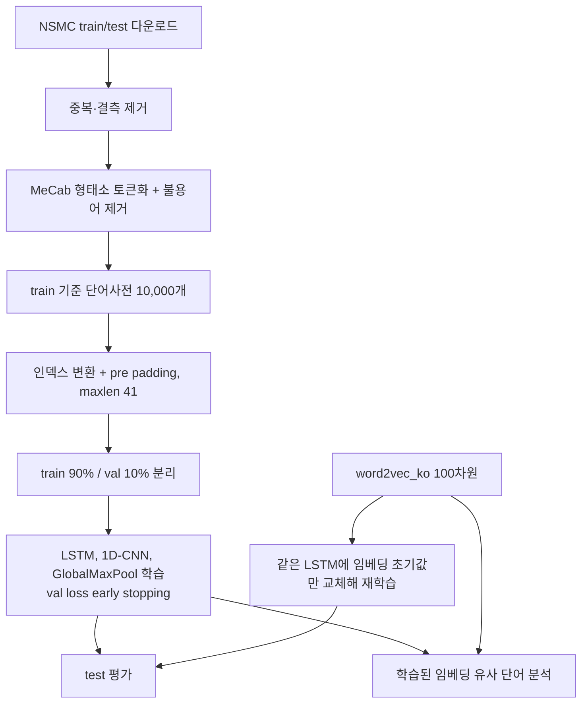

# Peer Review Template

- 코더: 박서준
- 리뷰어: 미정

> 아래 내용은 업로드된 노트북을 바탕으로 정리한 점검 메모입니다. 동료 리뷰는 아직 받지 않았습니다.

## 결과 요약

[네이버 영화리뷰 감성분석 노트북](./NSMC_sentiment_project.ipynb)

| 모델 | best epoch | val acc | test acc |
|---|---|---|---|
| LSTM | 4 | 0.8600 | 0.8570 |
| 1D-CNN | 3 | 0.8561 | 0.8510 |
| GlobalMaxPool | 7 | 0.8325 | 0.8281 |
| LSTM (post padding) | 4 | 0.8590 | 0.8562 |
| LSTM + word2vec_ko | 4 | 0.8686 | 0.8628 |

모델과 epoch는 val loss로 골랐고, test는 모델마다 한 번씩만 평가했습니다.

## 실행 흐름

## PRT (Peer Review Template)

- [x] **1. 주어진 문제를 해결하는 완성된 코드가 제출되었나요?**
  - 루브릭 세 항목을 모두 노트북에서 확인할 수 있습니다.
  - 분류 모델 3종(LSTM, 1D-CNN, GlobalMaxPool)을 학습했고, 추가로 post padding LSTM과 word2vec_ko 초기화 LSTM을 비교했습니다.
  - 7) 섹션에서 gensim `most_similar`로 자체 학습 임베딩과 word2vec_ko의 유사 단어를 같은 단어 8개에 대해 비교했습니다.
  - test 정확도는 LSTM + word2vec_ko 86.28%, LSTM 85.70%로 85% 기준을 넘었습니다.

- [x] **2. 핵심 코드의 주석이나 docstring을 보고 이해할 수 있나요?**
  - `load_data()`, `pad_sequences()`, 모델 클래스 3개, `train_model()`에 역할을 설명하는 docstring이 있습니다.
  - `train_model()`은 val loss가 2번 연속 나빠지면 멈추고 가장 좋았던 epoch의 가중치로 되돌립니다. 모든 모델 비교가 이 함수를 거치기 때문에 핵심 코드로 봤습니다.

- [x] **3. 오류를 해결한 기록이나 추가 실험이 있나요?**
  - 원본의 `python-mecab-ko` 설치가 Colab(Python 3.13)에서 wheel 빌드 실패로 동작하지 않아, KoNLPy + mecab-ko + mecab-python3에 `MECABRC`와 사전 경로를 지정하는 방법으로 바꿨습니다. 실패한 셀의 출력도 그대로 남겼습니다.
  - 원본 `load_data()`의 특수 토큰이 빈 문자열 네 개라 인덱스가 겹치는 문제를 찾아 `<PAD>`, `<BOS>`, `<UNK>`, `<UNUSED>`로 고쳤습니다.
  - 노드에서 다룬 pre/post padding 차이를 NSMC에서 직접 비교했고, maxlen이 41로 짧아서인지 차이가 거의 없었습니다(test 0.08%p).

- [x] **4. 회고와 실행 흐름이 정리되어 있나요?**
  - 그래프마다 바로 아래에 해석을 적었고, 노트북 마지막과 아래에 KPT(Keep, Problem, Try) 회고를 정리했습니다.
  - 실행 흐름은 위 다이어그램으로 정리했습니다.

- [ ] **5. 코드가 간결하고 효율적인가요?**
  - 학습, 평가, 패딩, 그래프를 함수로 분리해 모델 5개에 같은 코드를 재사용했습니다.
  - PEP 8 전체 준수 여부는 검증하지 않았습니다.

## 회고 (KPT)

### Keep
- 모델과 epoch는 val loss로만 고르고, test는 모델마다 한 번씩만 평가했습니다. val과 test 순위가 같았고 차이도 0.3에서 0.5%p 정도여서 이렇게 고른 결과를 믿을 수 있었습니다.
- 에러 없이 돌아가는 원본 코드도 그대로 쓰지 않고 사전을 직접 확인했습니다. 이 과정에서 `load_data`의 특수 토큰이 빈 문자열이라 인덱스가 겹치는 문제를 찾았습니다.
- 노드에서 나온 내용(pre padding이 10% 이상 유리)을 NSMC로 직접 비교해 봤고, 문장이 짧은 데이터에서는 차이가 거의 없다는 것을 확인했습니다.
- word2vec 실험은 LSTM 구조와 하이퍼파라미터를 그대로 두고 임베딩 초기값만 바꿔서, 바뀐 조건이 하나만 있도록 비교했습니다.

### Problem
- 교재의 MeCab 설치 방법이 Colab(Python 3.13)에서 동작하지 않아 설치 단계에서 시간이 걸렸습니다.
- 모델마다 seed 하나로 한 번씩만 학습해서, 0.5%p 안쪽의 차이(LSTM과 1D-CNN, pre와 post)는 우연일 수 있습니다. 같은 seed로 다시 실행했을 때도 val 정확도가 0.06%p 달라졌습니다.
- word2vec_ko에 없는 이모티콘과 줄임말(ㅋㅋ, ㅠㅠ, 강추 등)은 감성 신호가 강한데도 랜덤 초기값에서 시작했습니다.
- word2vec_ko에서 '최고'와 '최악'이 가깝게 나오는 것처럼, 사전학습 임베딩이 반대 감성의 단어를 구분하지 못하는 경우가 있었습니다.
- word2vec_ko 파일이 LMS 실습환경의 /data에만 있어서, 그 환경에서 KeyedVectors만 저장해 Colab으로 옮겼습니다. 벡터 값은 같지만 실행 환경이 두 곳으로 나뉘었습니다.

### Try
- seed를 3개 이상으로 바꿔 반복하고, 평균과 편차로 모델을 비교해 보고 싶습니다.
- 리뷰 데이터로 Word2Vec을 추가 학습하거나 이모티콘과 줄임말을 따로 처리해서, 사전학습 임베딩에 없는 감성 단어를 보완해 보고 싶습니다.
- 양방향 LSTM, 임베딩을 처음 몇 epoch 동안 고정했다가 푸는 방식, 사전 크기(num_words) 변경을 val 기준으로 비교해 보고 싶습니다.

## 리뷰어 회고 및 개선 제안

동료 리뷰 대기 중입니다.

### 참고
- [NSMC 데이터셋](https://github.com/e9t/nsmc)
- [gensim KeyedVectors](https://radimrehurek.com/gensim/models/keyedvectors.html)
