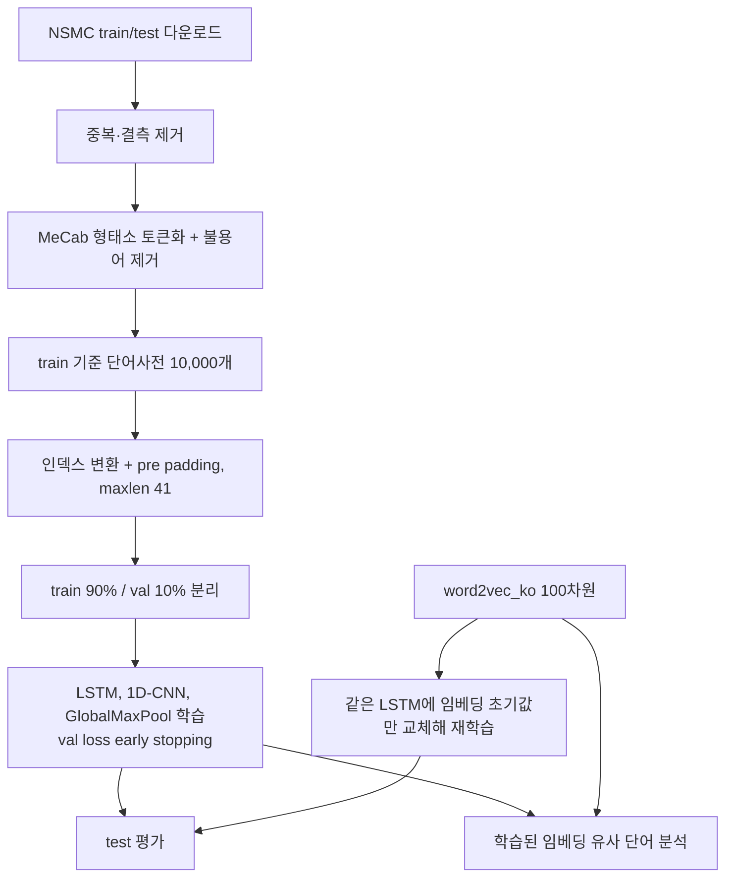

# Peer Review Template

- 코더: 박서준
- 리뷰어: 미정

> 아래 내용은 업로드된 노트북을 바탕으로 정리한 점검 메모입니다. 동료 리뷰는 아직 받지 않았습니다.

## 결과 요약

[네이버 영화리뷰 감성분석 노트북](./NSMC_sentiment_project.ipynb)

| 모델 | best epoch | val acc | test acc |
|---|---|---|---|
| LSTM | 4 | 0.8600 | 0.8570 |
| 1D-CNN | 3 | 0.8561 | 0.8510 |
| GlobalMaxPool | 7 | 0.8325 | 0.8281 |
| LSTM (post padding) | 4 | 0.8590 | 0.8562 |
| LSTM + word2vec_ko | 4 | 0.8686 | 0.8628 |

모델과 epoch는 val loss로 골랐고, test는 모델마다 한 번씩만 평가했습니다.

## 실행 흐름

## PRT (Peer Review Template)

- [x] **1. 주어진 문제를 해결하는 완성된 코드가 제출되었나요?**
  - 루브릭 세 항목을 모두 노트북에서 확인할 수 있습니다.
  - 분류 모델 3종(LSTM, 1D-CNN, GlobalMaxPool)을 학습했고, 추가로 post padding LSTM과 word2vec_ko 초기화 LSTM을 비교했습니다.
  - 7) 섹션에서 gensim `most_similar`로 자체 학습 임베딩과 word2vec_ko의 유사 단어를 같은 단어 8개에 대해 비교했습니다.
  - test 정확도는 LSTM + word2vec_ko 86.28%, LSTM 85.70%로 85% 기준을 넘었습니다.

- [x] **2. 핵심 코드의 주석이나 docstring을 보고 이해할 수 있나요?**
  - `load_data()`, `pad_sequences()`, 모델 클래스 3개, `train_model()`에 역할을 설명하는 docstring이 있습니다.
  - `train_model()`은 val loss가 2번 연속 나빠지면 멈추고 가장 좋았던 epoch의 가중치로 되돌립니다. 모든 모델 비교가 이 함수를 거치기 때문에 핵심 코드로 봤습니다.

- [x] **3. 오류를 해결한 기록이나 추가 실험이 있나요?**
  - 원본의 `python-mecab-ko` 설치가 Colab(Python 3.13)에서 wheel 빌드 실패로 동작하지 않아, KoNLPy + mecab-ko + mecab-python3에 `MECABRC`와 사전 경로를 지정하는 방법으로 바꿨습니다. 실패한 셀의 출력도 그대로 남겼습니다.
  - 원본 `load_data()`의 특수 토큰이 빈 문자열 네 개라 인덱스가 겹치는 문제를 찾아 `<PAD>`, `<BOS>`, `<UNK>`, `<UNUSED>`로 고쳤습니다.
  - 노드에서 다룬 pre/post padding 차이를 NSMC에서 직접 비교했고, maxlen이 41로 짧아서인지 차이가 거의 없었습니다(test 0.08%p).

- [x] **4. 회고와 실행 흐름이 정리되어 있나요?**
  - 그래프마다 바로 아래에 해석을 적었고, 노트북 마지막에 배운 점, 아쉬운 점, 다음에 해볼 것을 정리했습니다.
  - 실행 흐름은 위 다이어그램으로 정리했습니다.

- [ ] **5. 코드가 간결하고 효율적인가요?**
  - 학습, 평가, 패딩, 그래프를 함수로 분리해 모델 5개에 같은 코드를 재사용했습니다.
  - PEP 8 전체 준수 여부는 검증하지 않았습니다.

## 한계

- 모델마다 seed 하나로 한 번씩만 학습했습니다. 같은 seed로 다시 실행해도 GPU의 LSTM 연산 때문에 val 정확도가 0.1%p 정도 달라지는 것을 확인했기 때문에, 0.5%p 안쪽의 차이는 우연일 수 있습니다.
- word2vec_ko.model은 LMS 실습환경의 /data에만 있어서, 그 환경에서 KeyedVectors만 저장한 파일을 Colab에 올려 사용했습니다.

## 리뷰어 회고 및 개선 제안

동료 리뷰 대기 중입니다.

### 참고
- [NSMC 데이터셋](https://github.com/e9t/nsmc)
- [gensim KeyedVectors](https://radimrehurek.com/gensim/models/keyedvectors.html)
