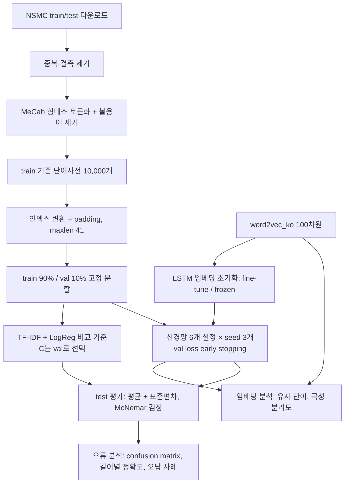

# Peer Review Template

- 코더: 박서준
- 리뷰어: 미정

> 아래 내용은 업로드된 노트북을 바탕으로 정리한 점검 메모입니다. 동료 리뷰는 아직 받지 않았습니다.

## 결과 요약

[네이버 영화리뷰 감성분석 노트북](./NSMC_sentiment_project.ipynb)

| 설정 | val acc (%) | test acc (%) |
|---|---|---|
| TF-IDF + LogReg (비교 기준) | 86.91 | 86.85 |
| LSTM + word2vec_ko (fine-tune) | 86.70 ± 0.12 | 86.51 ± 0.11 |
| LSTM-post | 86.13 ± 0.25 | 85.64 ± 0.28 |
| LSTM | 85.97 ± 0.05 | 85.75 ± 0.04 |
| 1D-CNN | 85.49 ± 0.17 | 85.18 ± 0.10 |
| LSTM + word2vec_ko (frozen) | 84.52 ± 0.34 | 84.17 ± 0.24 |
| GlobalMaxPool | 83.79 ± 0.17 | 83.35 ± 0.24 |

신경망은 seed 42, 43, 44로 3번 학습한 평균 ± 표준편차입니다. 모델과 epoch는 validation loss로 골랐고, test는 학습이 끝난 뒤 보고용으로만 평가했습니다.

- RQ1 (모델 구조): LSTM > 1D-CNN > GlobalMaxPool 순이고 차이는 seed 편차보다 큽니다. 다만 TF-IDF + 로지스틱 회귀가 모든 신경망보다 높았습니다.
- RQ2 (padding 방향): pre와 post는 차이가 없었습니다(방향이 일정하지 않고 표준편차 안).
- RQ3 (사전학습 임베딩): word2vec_ko로 초기화하고 같이 학습하면 +0.76%p(McNemar p < 1e-6, seed 3개 모두), 고정하면 -1.6%p였습니다. word2vec_ko는 감성 극성을 거의 구분하지 못해서(극성 분리도 0.017) 다시 학습할 때만 도움이 됐습니다.

## 실행 흐름

## PRT (Peer Review Template)

- [x] **1. 주어진 문제를 해결하는 완성된 코드가 제출되었나요?**
  - 루브릭 세 항목을 모두 노트북에서 확인할 수 있습니다.
  - 분류 모델 3종(LSTM, 1D-CNN, GlobalMaxPool)에 post padding LSTM, word2vec_ko fine-tune / frozen LSTM, TF-IDF + 로지스틱 회귀를 더해 비교했습니다.
  - 7) 섹션에서 gensim `most_similar`로 자체 학습 임베딩과 word2vec_ko의 유사 단어를 비교하고, 긍정/부정 단어 묶음의 극성 분리도로 수치화했습니다.
  - 85% 기준은 LSTM, LSTM-post, 1D-CNN, LSTM + word2vec_ko(fine-tune)가 넘었습니다.

- [x] **2. 핵심 코드의 주석이나 docstring을 보고 이해할 수 있나요?**
  - `load_data()`, `pad_sequences()`, 모델 클래스 3개, `train_model()`, `run_config()`, `polarity_separation()`에 역할을 설명하는 docstring이 있습니다.
  - `run_config()`는 같은 설정을 seed마다 학습하고, 선택은 run마다 val loss로 하고 test는 보고용으로만 계산합니다. 모든 비교가 이 함수를 거치기 때문에 핵심 코드로 봤습니다.

- [x] **3. 오류를 해결한 기록이나 추가 실험이 있나요?**
  - 원본의 `python-mecab-ko` 설치가 Colab(Python 3.13)에서 wheel 빌드 실패로 동작하지 않아, KoNLPy + mecab-ko + mecab-python3에 `MECABRC`와 사전 경로를 지정하는 방법으로 바꿨습니다. 실패한 셀의 출력도 그대로 남겼습니다.
  - 원본 `load_data()`의 특수 토큰이 빈 문자열 네 개라 인덱스가 겹치는 문제를 찾아 `<PAD>`, `<BOS>`, `<UNK>`, `<UNUSED>`로 고쳤습니다.
  - 추가 실험: pre/post padding 비교, TF-IDF 비교 기준, word2vec frozen vs fine-tune, McNemar 검정, 오류 분석(confusion matrix, 길이별 정확도, 확신을 갖고 틀린 리뷰 10개 분류).

- [x] **4. 회고와 실행 흐름이 정리되어 있나요?**
  - 그래프마다 바로 아래에 해석을 적었고, 노트북 마지막에 결론(RQ별 답)과 KPT 회고를 정리했습니다.
  - 실행 흐름은 위 다이어그램으로 정리했습니다.

- [ ] **5. 코드가 간결하고 효율적인가요?**
  - 학습, 평가, 패딩, 그래프, 요약표를 함수로 분리해 7개 설정에 같은 코드를 재사용했습니다.
  - PEP 8 전체 준수 여부는 검증하지 않았습니다.

## 회고 (KPT)

### Keep
- 연구 질문 세 개를 먼저 정하고 비교할 때 바꾸는 조건을 하나로 제한했습니다. 그래서 frozen과 fine-tune 비교처럼 word2vec이 왜 도움이 되는지까지 나눠서 볼 수 있었습니다.
- seed 3개 반복과 McNemar 검정으로 0.76%p라는 작은 차이가 우연이 아닌지 확인했습니다. 반대로 pre와 post의 차이는 seed 편차 안이라 차이가 없다고 정리했습니다.
- 신경망끼리만 비교하지 않고 TF-IDF + 로지스틱 회귀를 기준으로 둔 덕분에, 이 설정의 신경망이 선형 모델보다 낫지 않다는 결과를 놓치지 않았습니다.
- 에러 없이 돌아가는 원본 코드도 사전을 직접 확인해서 `load_data`의 특수 토큰 버그를 찾았습니다.

### Problem
- 신경망은 한 가지 설정(임베딩 100, hidden 128, lr 1e-3)으로만 학습했고 TF-IDF는 C를 validation으로 골라서, 두 방식의 튜닝 정도가 같지 않습니다.
- 사전 10,000개 때문에 test 문장의 41.5%에 <UNK>가 들어갑니다. 모든 모델에 같은 조건이지만 전체 성능의 상한을 낮췄을 수 있습니다.
- GlobalMaxPool은 한 seed에서 최대 epoch(10)까지 학습이 이어져서 충분히 수렴했다고 보기 어렵습니다.
- 확신을 갖고 틀린 리뷰 10개 중 4개는 글과 라벨이 반대로 보였습니다. 라벨 잡음이 정확도의 상한을 낮추는 것으로 보이지만, 10개만 봤기 때문에 비율은 일반화할 수 없습니다.
- 교재의 MeCab 설치 방법이 Colab(Python 3.13)에서 동작하지 않았고, word2vec_ko가 LMS 실습환경에만 있어서 실행 환경이 두 곳으로 나뉘었습니다.

### Try
- 사전 크기(10,000, 30,000, 전체)와 LSTM의 hidden 크기, 학습률을 validation으로 함께 튜닝해서 TF-IDF와 공정하게 다시 비교해 보고 싶습니다.
- 리뷰 데이터로 Word2Vec을 추가 학습하거나 이모티콘과 줄임말을 따로 처리해서, 극성 정보를 담은 임베딩을 만들어 보고 싶습니다.
- 글과 라벨이 반대로 보이는 리뷰를 더 많이 뽑아 읽어서 라벨 잡음 비율을 추정해 보고 싶습니다.

## 리뷰어 회고 및 개선 제안

동료 리뷰 대기 중입니다.

### 참고
- [NSMC 데이터셋](https://github.com/e9t/nsmc)
- [gensim KeyedVectors](https://radimrehurek.com/gensim/models/keyedvectors.html)
- McNemar, Q. (1947). Note on the sampling error of the difference between correlated proportions or percentages. Psychometrika, 12(2), 153–157.
